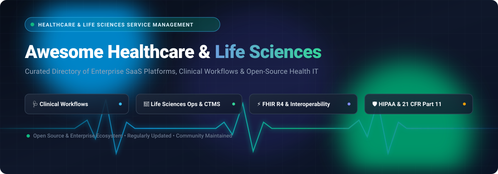

<p align="center">
  
</p>

<p align="center">
  <a href="https://github.com/ishandutta2007/Awesome-Awesome-Awesome"></a><a href="https://discord.gg/jc4xtF58Ve"></a>
  <a href="https://github.com/ishandutta2007/Awesome-Healthcare-Life-Sciences-Service-Management/stargazers"></a>
  <a href="https://github.com/ishandutta2007/Awesome-Healthcare-Life-Sciences-Service-Management/network/members"></a>
  <a href="https://github.com/ishandutta2007/Awesome-Healthcare-Life-Sciences-Service-Management/blob/main/LICENSE"></a>
  <a href="https://github.com/ishandutta2007/Awesome-Healthcare-Life-Sciences-Service-Management/pulls"></a>
  <a href="https://github.com/ishandutta2007"></a>
</p>

---

# 🏥 Awesome Healthcare & Life Sciences Service Management

> **A comprehensive, SEO-optimized directory of top SaaS platforms and open-source GitHub projects dedicated to Healthcare & Life Sciences Service Management (HCLS-SM), Clinical Workflow Automation, Provider Operations, Electronic Health Records (EHR), and Clinical Trial Management Systems (CTMS).**

**Last updated:** October 2026 🗓️  
**Focus Areas:** *Clinical Workflow Orchestration • Provider Operations & Credentialing • Life Sciences Service Delivery • Patient 360 & Portals • HL7 / FHIR Interoperability • HIPAA & 21 CFR Part 11 Regulatory Compliance*

---

## 📑 Table of Contents

- [📊 Sector Overview & Market Dynamics](#-sector-overview--market-dynamics)
- [☁️ SaaS & Hosted Platforms](#️-saas--hosted-platforms)
  - [SaaS Solutions Comparison Table](#saas-solutions-comparison-table)
  - [Detailed SaaS Profiles](#detailed-saas-profiles)
- [🔓 Open-Source GitHub Projects](#-open-source-github-projects)
  - [Open-Source Solutions Ranking](#open-source-solutions-ranking)
  - [Detailed Open-Source Profiles](#detailed-open-source-profiles)
- [🏗️ Recommended Architecture & Frameworks](#️-recommended-architecture--frameworks)
- [🤝 How to Contribute](#-how-to-contribute)
- [💖 Support & Sponsoring](#-support--sponsoring)
- [📈 Star History](#-star-history)
- [⚖️ Disclaimer](#️-disclaimer)

---

## 📊 Sector Overview & Market Dynamics

The global **Healthcare & Life Sciences Service Management** and Healthcare IT software market is valued at approximately **$180+ Billion in 2026** and projected to exceed **$390 Billion by 2032**, expanding at a robust **Compound Annual Growth Rate (CAGR) of ~13.8%**, driven by acute clinical staffing shortages, expanding regulatory oversight (HIPAA, 21 CFR Part 11, EU MDR), widespread adoption of HL7 FHIR standards, and rapid incorporation of clinical AI agents into hospital and lab operations.

The sector demonstrates **moderate concentration at the enterprise core**—anchored by dominant multi-billion-dollar platform titans (Epic, Oracle Health, ServiceNow, and Veeva Systems) that command deeply entrenched clinical systems of record and substantial switching costs across major health systems and biopharmas—while remaining **highly fragmented across specialized ambulatory clinics, niche clinical trial workflows, and regional digital health verticals**, catalyzing extensive opportunities for agile SaaS innovators and sovereign, FHIR-native open-source solutions.

---

## ☁️ SaaS & Hosted Platforms

The following enterprise platforms represent the category leaders in healthcare workflow management, provider operational systems, and life sciences cloud infrastructure.

### SaaS Solutions Comparison Table

*Sorted descending by company size (Valuation / Market Capitalization).*

| 🏢 Platform / Solution | 💰 Company Size (Valuation / Mkt Cap) | 🏷️ Starting Pricing | ⏱️ Free Tier / Trial Limits | 🎯 Primary Focus & Strengths |
| :--- | :--- | :--- | :--- | :--- |
| **[Oracle Health (Cerner)](https://www.oracle.com/health/)** | **$440B+ Mkt Cap** (Oracle) / $53B+ Annual Rev *(Cerner acquired for $28.3B)* | **$25 – $150 / user / month** (cloud ambulatory tier) or ~$5,000 / provider annual base | **No free tier**; 30-day sandbox pilot and tailored clinical walkthrough for qualified institutions | Enterprise EHR (Millennium), HealtheLife patient portal, Oracle Access Governance, and acute care management |
| **[ServiceNow HCLS-SM](https://www.servicenow.com/)** | **$190B+ Mkt Cap** / $11B+ Annual Rev | **$100 – $160 / fulfiller / month** (Core Pro tier; $160–$250/mo with Now Assist AI agents) | **No production free tier**; Free Personal Developer Instance (PDI) on Now Platform + 30-day guided enterprise PoC | Patient 360, EMR Help, Vaccine Administration, Pre-Visit Intake, and Redox EHR integrations |
| **[Epic Systems](https://www.epic.com/)** | **~$45B Private Valuation** / $4.9B Annual Rev | **$200 – $350 / provider / month** (Community Connect / Garden Plot) or ~$5,000 upfront / physician | **No free tier**; 1 to 2-week guided architectural evaluation sessions for health systems upon RFP | Leading US hospital EHR, MyChart patient portal, Healthy Planet population health, and Care Everywhere |
| **[IQVIA Technologies](https://www.iqvia.com/)** | **$42B+ Mkt Cap** / $15B+ Annual Rev | **$180 – $300 / user / month** (OCE modules) or ~$25,000+ / year per clinical study suite | **No free tier**; 14-to-30 day interactive sandbox demo / trial environment upon sales qualification | Orchestrated Clinical Trials (OCT), site digital engagement, and life sciences commercial operations |
| **[Veeva Systems](https://www.veeva.com/)** | **$34B+ Mkt Cap** / $2.6B+ Annual Rev | **$120 – $200 / user / month** (Vault CRM) or ~$500+ / user / month (Vault Clinical/Safety) | **Veeva SiteVault Free forever plan** (up to 20 active clinical studies for trial sites); 14-day demo for CRM | 21 CFR Part 11 compliant Vault CRM, EDC/CTMS, eTMF, regulatory documentation, and safety operations |
| **[Athenahealth](https://www.athenahealth.com/)** | **$17B Private Valuation** *(Acquired 2022)* / $2.0B+ Annual Rev | **$140 / provider / month** base license fee + 4% to 8% of monthly practice collections | **No free tier**; 14-day interactive guided product walkthrough and sandbox demo upon sales request | Cloud ambulatory EHR (athenaClinicals), billing/RCM (athenaCollector), and athenaCommunicator patient portal |
| **[symplr](https://www.symplr.com/)** | **$4.5B Private Valuation** / $550M+ Annual Rev | **$6,500 / year** baseline package for credentialing / provider directory modules | **No free tier**; 14-to-30 day scoped demo environment and proof-of-concept for hospital networks | Provider lifecycle management, credentialing, peer review (OPPE/FPPE), and symplr Safety event reporting |
| **[Innovaccer](https://innovaccer.com/)** | **$3.2B Private Valuation** / $170M+ Annual Rev | **$0.25 – $0.35 Per Member Per Month (PMPM)** base platform tier on cloud marketplaces | **No free tier**; 30-day proof-of-concept (POC) sandbox pilot available for qualified health systems & ACOs | Healthcare Intelligence Cloud, Atlas Population Health OS, value-based care optimization, and clinical AI agents |
| **[NextGen Healthcare](https://www.nextgen.com/)** | **$1.8B Private Valuation** *(Acquired 2023)* / $700M+ Annual Rev | **$299 – $499 / provider / month** (NextGen Office small-to-mid practice cloud tier) | **No free tier**; 14-day guided product demonstration and practice workflow assessment | Ambulatory EHR & PM, Ambient Assist AI clinical documentation, and Patient Engage intake |
| **[Meditech](https://www.meditech.com/)** | **$1.6B Private Valuation** / $550M+ Annual Rev | **$120 – $250 / provider / month** under MEDITECH-as-a-Service (MaaS) subscription | **No free tier**; Structured multi-week pilot demonstration and workflow assessment upon RFP | Expanse EHR, Traverse Exchange interoperability network, Care Compass population registries, and point-of-care apps |

---

### Detailed SaaS Profiles

#### 1. 🏥 [Oracle Health (Cerner)](https://www.oracle.com/health/)
- **Overview:** Enterprise Electronic Health Record (Oracle Health EHR / Cerner Millennium) and healthcare service platform running on high-performance Oracle Cloud Infrastructure (OCI).
- **Key Modules:** HealtheLife Patient Portal, Oracle Access Governance role management, Ambulatory Care Management, Acute Clinical Documentation, and Revenue Cycle solutions.
- **Compliance & Security:** HIPAA, FedRAMP High, HITRUST CSF, and SOC 2 Type II certified.

#### 2. ⚡ [ServiceNow Healthcare & Life Sciences Service Management](https://www.servicenow.com/)
- **Overview:** Built on the Now Platform, HCLS-SM connects clinical systems, payers, and patient requests into unified digital workflows.
- **Key Modules:** Patient 360 Workspace, Consent Management, Vaccine Administration Management, EMR Help ticket integration, and Redox Inbound FHIR integrations.
- **Compliance & Security:** HIPAA-compliant configurations, HITRUST certified, role-based PHI encryption.

#### 3. 🌐 [Epic Systems](https://www.epic.com/)
- **Overview:** The cornerstone clinical system of record for majority US academic medical centers and major hospital networks.
- **Key Modules:** MyChart patient engagement portal, Healthy Planet population health registries, Care Everywhere nationwide record exchange, and Cosmos big-data clinical research database.
- **Compliance & Security:** ONC Health IT certified, HIPAA, robust role-based audit trailing.

#### 4. 🔬 [IQVIA Technologies](https://www.iqvia.com/)
- **Overview:** The premier life sciences clinical and commercial operations suite, recognized globally for Orchestrated Clinical Trials (OCT).
- **Key Modules:** Digital Trial Planning, Digital Site Suite, Patient Portal & Remote Consent, Clinical Data Analytics, and Orchestrated Customer Engagement (OCE).
- **Compliance & Security:** 21 CFR Part 11, GAMP 5, GCP, GDPR, and HIPAA compliant.

#### 5. 💊 [Veeva Systems](https://www.veeva.com/)
- **Overview:** Purpose-built life sciences cloud spanning commercial sales engagement and clinical development.
- **Key Modules:** Veeva Vault CRM, Vault EDC (Electronic Data Capture), Vault eTMF, Vault CTMS, Veeva SiteVault (site research eRegulatory), and QualityDocs.
- **Compliance & Security:** Pre-validated for FDA 21 CFR Part 11, Annex 11, GxP, and PDMA compliance.

#### 6. 🩺 [Athenahealth](https://www.athenahealth.com/)
- **Overview:** Cloud-native ambulatory practice management and clinical service suite backed by an interconnected network of 160,000+ clinicians.
- **Key Modules:** athenaClinicals (EHR), athenaCollector (automated billing & claims scrubbing), athenaCommunicator (patient self-scheduling & messaging).
- **Compliance & Security:** ONC 2015 Edition Cures Update certified, HIPAA, PCI-DSS compliant.

#### 7. 🛡️ [symplr](https://www.symplr.com/)
- **Overview:** Healthcare operations and governance platform specializing in enterprise provider credentialing, compliance, and hospital quality management.
- **Key Modules:** symplr Directory (integrated provider data engine with Epic), symplr Credentialing, Ongoing Professional Practice Evaluation (OPPE/FPPE), and symplr Safety event reporting.
- **Compliance & Security:** NCQA-accredited, HIPAA compliant, Joint Commission audit ready.

#### 8. 🧠 [Innovaccer](https://innovaccer.com/)
- **Overview:** Healthcare Intelligence Cloud orchestrating patient data, value-based care contracts, and clinical AI assistants.
- **Key Modules:** Atlas Population Health Operating System (launched 2026), Gravity Data Platform, Galaxy EHR integrations, Care Management, and AI-assisted clinical copilots.
- **Compliance & Security:** HITRUST CSF, HIPAA, SOC 2 Type II, and ISO 27001 certified.

#### 9. 📱 [NextGen Healthcare](https://www.nextgen.com/)
- **Overview:** Specialized ambulatory care platform providing practice management, telehealth, and AI clinical documentation.
- **Key Modules:** NextGen Enterprise EHR/PM, Ambient Assist (generative AI medical scribe), NextGen Mobile point-of-care app, and Patient Engage intake.
- **Compliance & Security:** ONC Certified Health IT, HIPAA compliant, EPCS certified.

#### 10. 🏥 [Meditech](https://www.meditech.com/)
- **Overview:** Web-based acute and ambulatory EHR platform delivering longitudinal patient records for community and regional health systems.
- **Key Modules:** Expanse Patient Care, Traverse Exchange interoperability engine, Care Compass population registries, and point-of-care mobile nursing interfaces.
- **Compliance & Security:** ONC Cures Update certified, HIPAA compliant, HL7 FHIR ready.

---

## 🔓 Open-Source GitHub Projects

Explore battle-tested open-source repositories for self-hosted hospital information systems (HIS), electronic medical records (EMR), FHIR interoperability engines, and clinical trial data capture frameworks.

### Open-Source Solutions Ranking

*Ranked descending by GitHub star count.*

| 🏆 Repository | ⭐ GitHub Star Badge | 💻 Tech Stack | 📜 License | 🩺 Primary Healthcare Function |
| :--- | :--- | :--- | :--- | :--- |
| **[HospitalRun](https://github.com/HospitalRun/hospitalrun-frontend)** | [](https://github.com/HospitalRun/hospitalrun-frontend/stargazers) | TypeScript, React, PouchDB | MIT | Offline-first hospital information system for rural & low-resource clinics |
| **[OpenEMR](https://github.com/openemr/openemr)** | [](https://github.com/openemr/openemr/stargazers) | PHP, JavaScript, MySQL | GPL-2.0 | Complete ONC-certified EHR, practice management, billing, and patient portal |
| **[Medplum](https://github.com/medplum/medplum)** | [](https://github.com/medplum/medplum/stargazers) | TypeScript, Node.js, Postgres | Apache-2.0 | Headless FHIR-native healthcare developer platform, clinical UI & patient portal |
| **[HAPI FHIR](https://github.com/hapifhir/hapi-fhir)** | [](https://github.com/hapifhir/hapi-fhir/stargazers) | Java, Spring, Hibernate | Apache-2.0 | Reference open-source HL7 FHIR standard implementation & data integration server |
| **[OpenMRS Core](https://github.com/openmrs/openmrs-core)** | [](https://github.com/openmrs/openmrs-core/stargazers) | Java, Spring, React | MPL-2.0 | Global enterprise medical record system deployed across 40+ countries |
| **[Open Hospital](https://github.com/informatici/openhospital)** | [](https://github.com/informatici/openhospital/stargazers) | Java, Spring Boot, Angular | GPL-3.0 | Multi-language hospital management for outpatient, inpatient, lab, & pharmacy |
| **[Marley Health](https://github.com/earthians/marley)** | [](https://github.com/earthians/marley/stargazers) | Python, Frappe, ERPNext | GPL-3.0 | ERP-integrated hospital management covering clinical procedures, labs, and billing |
| **[DHIS2 Core](https://github.com/dhis2/dhis2-core)** | [](https://github.com/dhis2/dhis2-core/stargazers) | Java, Spring, PostgreSQL | BSD-3-Clause | National health information management system, routine data, and disease tracker |
| **[OHDSI Atlas](https://github.com/OHDSI/Atlas)** | [](https://github.com/OHDSI/Atlas/stargazers) | JavaScript, R, OMOP CDM | Apache-2.0 | Life sciences real-world evidence (RWE), cohort creation, and clinical trial studies |
| **[VITALIt OS](https://github.com/basedavishkar/vitalit-os)** | [](https://github.com/basedavishkar/vitalit-os/stargazers) | Next.js, FastAPI, PostgreSQL | MIT | Modern, lightweight self-hostable clinic and hospital management dashboard |
| **[Clinic EDC](https://github.com/clinicedc/clinicedc)** | [](https://github.com/clinicedc/clinicedc/stargazers) | Python, Django, PostgreSQL | GPL-3.0 | Multisite longitudinal clinical trials electronic data capture framework |
| **[Ciyex EHR](https://github.com/ciyex-org/ciyex)** | [](https://github.com/ciyex-org/ciyex/stargazers) | Java 21, Spring Boot, Docker | Apache-2.0 | Multi-tenant FHIR R4-native outpatient EHR with AI assist and telemedicine |

---

### Detailed Open-Source Profiles

#### 1. 🏥 [HospitalRun](https://github.com/HospitalRun/hospitalrun-frontend) [](https://github.com/HospitalRun/hospitalrun-frontend/stargazers)
- **Description:** Designed specifically for hospitals and clinics in developing nations and low-resource environments. Features an offline-first architecture allowing uninterrupted clinical charting during connectivity blackouts.
- **Core Modules:** Outpatient triage, patient charting, medication inventory, surgical scheduling, and lab reporting.

#### 2. 📋 [OpenEMR](https://github.com/openemr/openemr) [](https://github.com/openemr/openemr/stargazers)
- **Description:** One of the world's most widely adopted open-source EHR platforms. Officially ONC Complete Ambulatory EHR certified with global community support.
- **Core Modules:** Fully integrated medical practice management, billing (EDI X12), patient portal, e-prescribing, clinical decision support, and FHIR API endpoints.

#### 3. ⚡ [Medplum](https://github.com/medplum/medplum) [](https://github.com/medplum/medplum/stargazers)
- **Description:** Next-generation headless healthcare platform delivering complete FHIR server infrastructure with React SDKs for rapidly building compliant clinical applications, patient portals, and lab integrations.
- **Core Modules:** FHIR R4 repository, OAuth2/OIDC identity management, audit logging, bots for workflow automation, and pre-built clinical UI components.

#### 4. 🔗 [HAPI FHIR](https://github.com/hapifhir/hapi-fhir) [](https://github.com/hapifhir/hapi-fhir/stargazers)
- **Description:** The industry-standard open-source Java implementation of the HL7 FHIR specification. Used globally as the backbone for health data exchange, national health registries, and clinical repositories.
- **Core Modules:** Complete FHIR client and server library, JPA storage layer, validation engine, terminology service, and SMART-on-FHIR security support.

#### 5. 🌍 [OpenMRS Core](https://github.com/openmrs/openmrs-core) [](https://github.com/openmrs/openmrs-core/stargazers)
- **Description:** Open-source electronic medical record platform conceived to combat HIV/AIDS, tuberculosis, and malaria, now expanded into an enterprise clinical workflow system.
- **Core Modules:** Clinical concept dictionary, patient cohort builder, encounter management, visit tracking, and REST/FHIR web services.

#### 6. 🩺 [Open Hospital](https://github.com/informatici/openhospital) [](https://github.com/informatici/openhospital/stargazers)
- **Description:** Free software created by ISF (Informatici Senza Frontiere) to facilitate healthcare administration in community hospitals and mission clinics.
- **Core Modules:** Inpatient admissions, outpatient consultations, pharmaceutical inventory, lab test tracking, surgical register, and billing.

#### 7. 🏭 [Marley Health](https://github.com/earthians/marley) [](https://github.com/earthians/marley/stargazers)
- **Description:** Built on Frappe and ERPNext, Marley bridges clinical healthcare delivery with enterprise back-office management in a single database.
- **Core Modules:** Patient appointment booking, clinical encounters, sample collection, rehabilitation sessions, pharmacy dispensing, and general ledger accounting.

#### 8. 📊 [DHIS2 Core](https://github.com/dhis2/dhis2-core) [](https://github.com/dhis2/dhis2-core/stargazers)
- **Description:** The world's largest health management information system (HMIS) platform, deployed at national scale across 70+ low- and middle-income countries.
- **Core Modules:** Aggregate health reporting, Tracker for individual longitudinal patient monitoring, GIS spatial mapping, and epidemiological analytics.

#### 9. 🔬 [OHDSI Atlas](https://github.com/OHDSI/Atlas) [](https://github.com/OHDSI/Atlas/stargazers)
- **Description:** Open-source analytics platform for the Observational Health Data Sciences and Informatics (OHDSI) community. Powers real-world evidence (RWE) studies across hundreds of millions of patient records.
- **Core Modules:** Cohort definition builder, patient-level prediction, population-level effect estimation, and standardized data quality dashboards on the OMOP Common Data Model.

#### 10. 🏥 [VITALIt OS](https://github.com/basedavishkar/vitalit-os) [](https://github.com/basedavishkar/vitalit-os/stargazers)
- **Description:** Modern, lightweight hospital and clinic administration platform crafted to eliminate expensive proprietary software licensing.
- **Core Modules:** Doctor/patient dashboards, appointment scheduling, inventory tracking, role-based security, and self-hosted Docker deployment.

#### 11. 🧪 [Clinic EDC](https://github.com/clinicedc/clinicedc) [](https://github.com/clinicedc/clinicedc/stargazers)
- **Description:** Electronic Data Capture (EDC) system purpose-built for multisite clinical trials and research epidemiological studies in partnership with Harvard T.H. Chan School of Public Health.
- **Core Modules:** Longitudinal subject tracking, scheduled visit CRFs, adverse event (AE) reporting, lab specimen tracking, and audit log tracking.

#### 12. 🩺 [Ciyex EHR](https://github.com/ciyex-org/ciyex) [](https://github.com/ciyex-org/ciyex/stargazers)
- **Description:** Modern multi-tenant clinical software engineered from the ground up for FHIR R4 interoperability, microservice deployments, and outpatient practice efficiency.
- **Core Modules:** Encounter charting, e-signatures, telehealth video visits (Jitsi/Twilio), Azure OpenAI charting assistance, and Keycloak multi-tenancy.

---

## 🏗️ Recommended Architecture & Frameworks

Building a modular, sovereign healthcare & life sciences technology stack without commercial vendor lock-in:

```
┌────────────────────────────────────────────────────────────────────────┐
│                   Unified Patient & Provider Experience                │
│       (Medplum React SDK / HospitalRun Frontend / Custom Web & App)    │
└───────────────────────────────────┬────────────────────────────────────┘
                                    │
    ┌───────────────────────────────┴───────────────────────────────┐
    ▼                                                               ▼
┌───────────────────────────────┐               ┌───────────────────────────────┐
│     Clinical & Outpatient     │               │   Enterprise ERP & Hospital   │
│         EHR Workflows         │               │          Operations           │
│      (OpenEMR / OpenMRS)      │               │     (Marley Health/Frappe)    │
└───────────────┬───────────────┘               └───────────────┬───────────────┘
                │                                               │
                └───────────────────────┬───────────────────────┘
                                        ▼
                        ┌───────────────────────────────┐
                        │  Interoperability & FHIR Core │
                        │    (HAPI FHIR / Medplum API)  │
                        └───────────────┬───────────────┘
                                        │
                ┌───────────────────────┴───────────────────────┐
                ▼                                               ▼
┌───────────────────────────────┐               ┌───────────────────────────────┐
│  Clinical Trials & Life Sci   │               │   Epidemiological Analytics   │
│      (Clinic EDC / OHDSI)     │               │        (DHIS2 Platform)       │
└───────────────────────────────┘               └───────────────────────────────┘
```

- **Foundational EHR**: Deploy **OpenEMR** or **OpenMRS** for clinical documentation, patient charts, and billing.
- **ERP Integration**: Integrate **Marley Health** for pharmacy stock, supplies, purchasing, HR, and accounting.
- **FHIR Interoperability API**: Utilize **Medplum** or **HAPI FHIR** as the central health data repository (CDR).
- **Clinical Trials & Life Sciences**: Deploy **Clinic EDC** for longitudinal protocol capture and **OHDSI Atlas** for observational research.

---

## 🤝 How to Contribute

Contributions from healthcare IT professionals, clinical informaticians, life sciences researchers, and software engineers are very welcome!

1. 🍴 **Fork** this repository.
2. 🌿 **Create a new branch**: `git checkout -b feature/add-new-platform`.
3. ✍️ **Add or refine an entry** in `README.md` adhering to the tabular structure and explicit pricing/star badge format.
4. 🔍 **Verify facts**: Link only to official product documentation or verified GitHub repositories.
5. 🚀 **Submit a Pull Request** with a descriptive explanation of your additions.

---

## 💖 Support & Sponsoring

If you find this curated directory useful for your organization, research, or development projects:

- ⭐ **Star this repository** to help others discover it!
- 🍴 **Fork and share** with colleagues in digital health, clinical informatics, and life sciences.
- ☕ **Sponsor the maintainer**: Support ongoing curation, research, and maintenance by visiting the [GitHub Sponsor Dashboard](https://github.com/sponsors/ishandutta2007).

<p align="center">
  <a href="https://github.com/sponsors/ishandutta2007">
    
  </a>
</p>

---

## 📈 Star History

[](https://star-history.dera.page/#ishandutta2007/Awesome-Healthcare-Life-Sciences-Service-Management&type=date&legend=top-left)

---

## ⚖️ Disclaimer

- **Community Curated:** This list is curated for educational and architectural reference purposes only and does not constitute an official commercial endorsement.
- **Regulatory Compliance Notice:** Healthcare and life sciences applications handling Protected Health Information (PHI) or clinical trial records must strictly comply with applicable regional and federal frameworks, including **HIPAA** (Health Insurance Portability and Accountability Act), **GDPR** (General Data Protection Regulation), **FDA 21 CFR Part 11**, and **GAMP 5**.
- **Production Validation:** Open-source repositories provide powerful architectural foundations but require comprehensive security hardening, data encryption in transit/rest, access auditing, and clinical safety validations before production clinical deployment.
- **Licensing:** Verify each repository's specific open-source license (MIT, Apache-2.0, GPL-2.0/3.0, MPL-2.0) before embedding into proprietary commercial platforms.

---

<p align="center">
  <b>Built with ❤️ for healthcare CIOs, clinical informaticians, life sciences operations leaders, and digital health engineers.</b>
</p>
